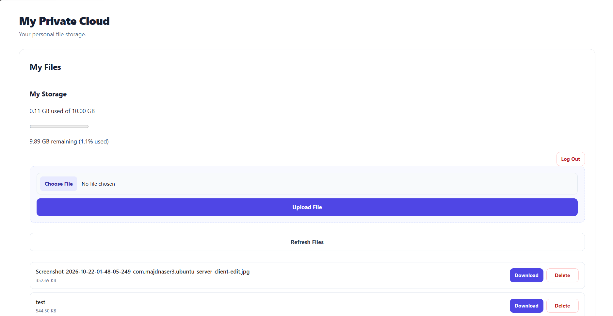
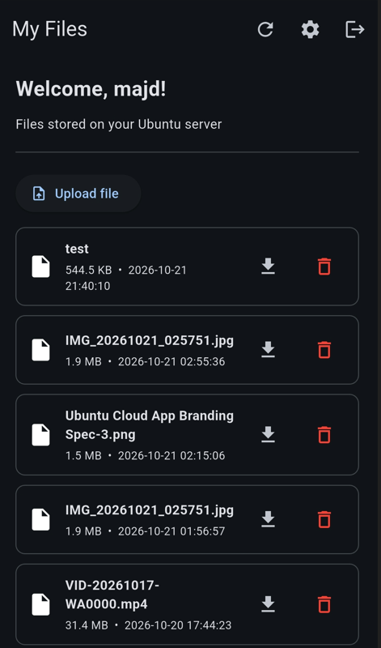
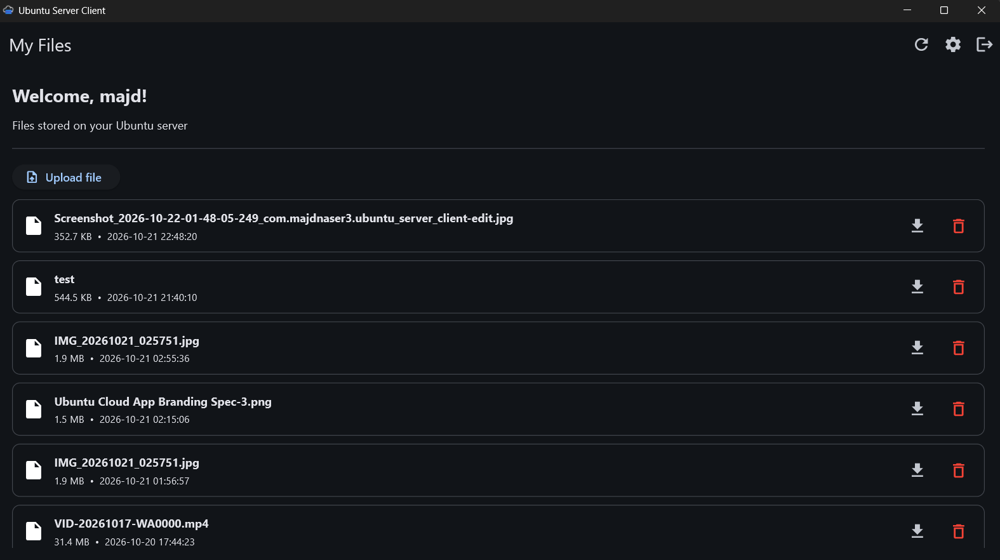
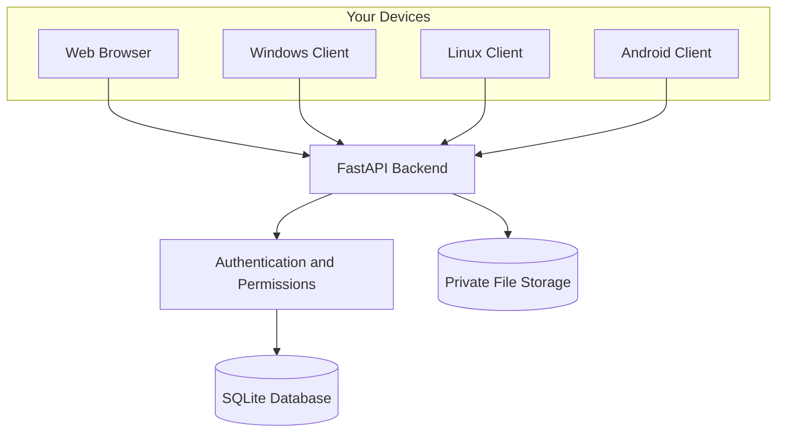

# Ubuntu Server Project

<p align="center">
  <strong>Your personal cloud. Your devices. Your control.</strong>
  <br />
  Turn an old laptop into a private, self-hosted file server accessible from your web browser, Windows PC, Linux desktop, and Android device.
  <br /><br />
  <a href="https://github.com/majdnaser3/ubuntu-server-project/stargazers"></a>
  <a href="https://github.com/majdnaser3/ubuntu-server-project/network/members"></a>
  <a href="https://github.com/majdnaser3/ubuntu-server-project/issues"></a>
  <a href="https://github.com/majdnaser3/ubuntu-server-project"></a>
</p>

<p align="center">
  <em>A practical, local-first personal cloud built with open-source tools.</em>
</p>

---

## 📸 See It in Action

Access your files through a browser or use a dedicated client on your devices.

<table>
  <tr>
    <td align="center" width="100%">
      <strong>🌐 Web Interface</strong><br />
      <a href="docs/images/web-dashboard.png">
        
      </a><br />
      <sub>Manage your files directly from your browser.</sub>
    </td>
  </tr>
  <tr>
    <td align="center">
      <strong>📱 Android Client</strong><br />
      <a href="docs/images/android-client.png">
        
      </a><br />
      <sub>Access your personal cloud from your phone.</sub>
    </td>
  </tr>
  <tr>
    <td align="center">
      <strong>🖥️ Windows Client</strong><br />
      <a href="docs/images/windows-client.png">
        
      </a><br />
      <sub>Manage your files from your desktop.</sub>
    </td>
  </tr>
</table>

> **Note:** Linux desktop support is also part of the project. A Linux screenshot can be added here as `docs/images/linux-client.png`.

---

## 🧭 Table of Contents

- [✨ Project Overview](#-project-overview)
- [🚀 Features](#-features)
- [🏗️ How It Works](#️-how-it-works)
- [💻 Supported Platforms](#-supported-platforms)
- [📁 Repository Structure](#-repository-structure)
- [⚙️ Requirements](#️-requirements)
- [🖥️ Set Up the Ubuntu Server](#️-set-up-the-ubuntu-server)
- [📦 Install and Run the Backend](#-install-and-run-the-backend)
- [🔐 Initial Administrator Setup](#-initial-administrator-setup)
- [🌐 Open the Web Interface](#-open-the-web-interface)
- [📲 Connect the Client Applications](#-connect-the-client-applications)
- [👥 Accounts and File Privacy](#-accounts-and-file-privacy)
- [💾 Storage and Upload Limits](#-storage-and-upload-limits)
- [🔧 Configuration Reference](#-configuration-reference)
- [🔌 API Overview](#-api-overview)
- [🗄️ Data Storage and Backups](#️-data-storage-and-backups)
- [🌍 Networking and Remote Access](#-networking-and-remote-access)
- [🛡️ Security Considerations](#️-security-considerations)
- [🧰 Troubleshooting](#-troubleshooting)
- [🧑‍💻 Development Setup](#-development-setup)
- [🧪 Testing and Verification](#-testing-and-verification)
- [⚠️ Current Limitations](#️-current-limitations)
- [🗺️ Roadmap](#️-roadmap)
- [🤝 Contributing](#-contributing)
- [📄 License](#-license)

---

## ✨ Project Overview

**Ubuntu Server Project** turns an old laptop running Ubuntu into a personal file server that you control.

Instead of relying entirely on a third-party cloud provider, you can host your own storage, manage user accounts, and access your files from supported devices connected to your network.

The project follows a **local-first approach**: get the server working on your local network first, then consider secure remote access as a separate step.

### 🎯 Project Goals

- ♻️ Give old hardware a useful second life.
- 🔒 Keep each user's files private by default.
- 📱 Provide access across different devices and platforms.
- 🧑‍🤝‍🧑 Support multiple user accounts.
- 🛠️ Make installation and administration understandable.
- 🌱 Build a reproducible open-source project that other people can learn from and deploy.

The goal is not just to build an application. It is to document the journey from a fresh Ubuntu installation to a working personal cloud.

## 🚀 Features

| Feature | Description |
|---|---|
| 🌐 Web interface | Access file management through a browser. |
| 🖥️ Desktop clients | Dedicated Windows and Linux applications. |
| 📱 Android client | Access the server from an Android device. |
| 🔐 Authentication | Register and sign in with user accounts. |
| 👥 Multiple users | Keep user accounts separate. |
| 📂 File management | Upload, list, download, and delete files. |
| 📊 Storage tracking | View storage usage and available quota. |
| 🧑‍💼 Administration | Configure user limits through administrator functionality. |
| ⚖️ Upload limits | Apply upload size limits to help protect server resources. |
| 🔑 First-admin setup | Create the initial administrator through a dedicated setup flow. |
| 🏠 Local-first operation | Start with devices on the same local network. |

Features and limitations can change as development continues. Consult the current code and release notes for the exact capabilities available in a particular version.

## 🏗️ How It Works

The server is the central point of the system. The supported clients communicate with a shared backend rather than maintaining separate file stores.



### Request flow

1. A user signs in through a supported client.
2. The client communicates with the FastAPI backend.
3. The backend authenticates requests and checks access permissions.
4. File operations use the server's storage and database.
5. The client displays the results to the user.

The backend is the shared foundation for the web, Windows, Linux, and Android experiences.

## 💻 Supported Platforms

| Platform | Role |
|---|---|
| Ubuntu Server | Hosts the backend, database, and files. |
| Web browser | Provides browser-based access. |
| Windows | Dedicated desktop client. |
| Linux | Dedicated desktop client. |
| Android | Mobile client. |

The server and clients have different requirements. The server needs a supported Python environment; client installation requirements depend on the platform and the available build artifacts.

## 📁 Repository Structure

The repository is organized into the following main areas:

```text
ubuntu-server-project/
├── backend/
│   ├── app/
│   │   ├── auth.py
│   │   ├── config.py
│   │   ├── database.py
│   │   ├── file_storage.py
│   │   └── main.py
│   └── requirements.txt
├── client/
│   ├── src/
│   └── pyproject.toml
├── frontend/
│   ├── index.html
│   ├── style.css
│   └── app.js
├── docs/
│   ├── architecture.md
│   ├── decisions.md
│   └── images/
├── .gitignore
└── README.md
```

Some generated build files, virtual environments, local databases, and private project notes are intentionally excluded from version control.

## ⚙️ Requirements

### Server

- A laptop or computer capable of running Ubuntu.
- Ubuntu and a working network connection.
- Python 3 and `venv`.
- Git.
- Sufficient disk space for the operating system, application, and stored files.

An old laptop can be sufficient for a small personal deployment, but performance depends on its hardware, workload, network, and storage device.

### Client devices

- A modern web browser for the web interface.
- Windows or Linux for the corresponding desktop client.
- Android for the mobile client.
- Network access to the server.

## 🖥️ Set Up the Ubuntu Server

These instructions describe a manual setup for development and initial local-network testing. They are not a substitute for a hardened production installation.

### 1. Update Ubuntu

Open a terminal on the Ubuntu server:

```bash
sudo apt update
sudo apt upgrade
```

### 2. Install the required tools

```bash
sudo apt install -y git python3 python3-venv python3-pip
```

### 3. Clone the repository

```bash
git clone https://github.com/majdnaser3/ubuntu-server-project.git
cd ubuntu-server-project
```

If you already cloned the repository, enter the existing project directory instead of cloning it again.

## 📦 Install and Run the Backend

### 1. Create a virtual environment

From the repository root:

```bash
python3 -m venv .venv
source .venv/bin/activate
```

### 2. Install Python dependencies

```bash
python -m pip install --upgrade pip
pip install -r backend/requirements.txt
```

### 3. Configure the required secrets

Generate a strong application secret:

```bash
python -c 'import secrets; print(secrets.token_urlsafe(48))'
```

Generate a separate setup token:

```bash
python -c 'import secrets; print(secrets.token_urlsafe(32))'
```

Store the two generated values securely. Do not commit them to Git or publish them in screenshots.

For an initial manual test, set the environment variables in the same terminal where you will run the backend:

```bash
export UBUNTU_SERVER_SECRET_KEY='REPLACE_WITH_YOUR_GENERATED_SECRET'
export UBUNTU_SERVER_SETUP_TOKEN='REPLACE_WITH_YOUR_SETUP_TOKEN'
export UBUNTU_SERVER_MAX_UPLOAD_MB=500
```

Replace both placeholders with the values you generated.

> **Important:** These shell variables apply to the current shell session. A future persistent service must receive its configuration through a secure service configuration mechanism.

### 4. Start the backend

From the repository root:

```bash
uvicorn app.main:app --app-dir backend --host 0.0.0.0 --port 8000
```

Keep the terminal running while testing. Stopping the process stops this manually launched server.

### 5. Check the health endpoint

On the server itself, open another terminal and run:

```bash
curl http://127.0.0.1:8000/health
```

A successful response indicates that the health endpoint is reachable. Consult the actual response if you need to determine the precise status format.

Interactive API documentation is available at:

```text
http://SERVER_IP:8000/docs
```

Replace `SERVER_IP` with the server's actual IP address.

## 🔐 Initial Administrator Setup

The initial administrator is created through the dedicated setup flow.

1. Start the backend with a securely generated `UBUNTU_SERVER_SECRET_KEY` and a separate `UBUNTU_SERVER_SETUP_TOKEN`.
2. Open the web interface or the setup flow supported by the current application.
3. Check the setup status.
4. Supply the required setup token and administrator credentials.
5. Complete the initial administrator creation.
6. Verify that the administrator can sign in and access administrator functionality.
7. Remove the setup token from the runtime environment and restart the backend after successful setup.

For the manual shell session, stop the backend with `Ctrl+C`, then run:

```bash
unset UBUNTU_SERVER_SETUP_TOKEN
```

Start the backend again with the secret key still configured:

```bash
uvicorn app.main:app --app-dir backend --host 0.0.0.0 --port 8000
```

**Security rule:** First-admin setup must not remain publicly available after an administrator has been configured. Verify the setup status and protection behavior before exposing the server to any network beyond your trusted LAN.

## 🌐 Open the Web Interface

Find the Ubuntu server's current local IP address. On Ubuntu, you can inspect network addresses with:

```bash
hostname -I
```

From a device connected to the same trusted Wi-Fi or LAN, open:

```text
http://SERVER_IP:8000
```

Replace `SERVER_IP` with the actual server address.

For example, if the server currently has the address `192.168.1.50`, the address would be:

```text
http://192.168.1.50:8000
```

That IP is only an example. Local IP addresses can change when a router assigns a new address.

Once the page opens, register or sign in as appropriate, then test the available file operations.

## 📲 Connect the Client Applications

The web interface and dedicated clients communicate with the same backend.

### General connection steps

1. Ensure the server is running.
2. Find its current reachable IP address.
3. Connect the client device to the same trusted network.
4. Open the client and enter the server address if prompted.
5. Sign in with an existing account.
6. Test listing, uploading, downloading, and deleting a harmless test file.

Use the exact server URL format requested by the particular client. For local testing, it will generally resemble:

```text
http://SERVER_IP:8000
```

Do not assume every client has the same setup screens or installation procedure. Follow the current client documentation and release artifacts for the platform you are installing.

### Windows

Use the Windows client build available for the project. Configure it to reach your Ubuntu server and sign in with your account.

### Linux

Use the Linux client build available for the project. Configure the server address and verify that file operations work.

### Android

Install the Android build available for the project. Make sure the phone can reach the server over the current network and that any active VPN or network isolation is not preventing access.

> If the server address changes, update the client configuration as needed.

## 👥 Accounts and File Privacy

The project supports multiple accounts. Each user should access their own files rather than automatically seeing another user's private files.

Authentication alone is not enough to guarantee privacy. Access checks must also be enforced by the backend for every protected operation, including file listing, download, deletion, and storage information.

Administrator access is separate from ordinary user access. Administrator functions should be restricted to authenticated, authorized administrators.

When evaluating or modifying the application, verify that:

- Users cannot list another user's private files.
- Users cannot download or delete another user's files by changing a file ID.
- File identifiers are checked against the authenticated user.
- Administrative endpoints reject unauthorized users.
- The initial administrator setup cannot be reused after setup is complete.

## 💾 Storage and Upload Limits

Files are stored on the server rather than separately on each client.

The project has configurable limits intended to control resource use and support per-user storage management.

| Setting | Default or behavior |
|---|---|
| Default user quota | 10,000,000,000 bytes (10 GB decimal), where applied by the current implementation. |
| Server maximum upload | 500 MiB by default. |
| Per-user upload limit | 500 MiB by default. |
| User quota | Administrator-adjustable through supported administration functionality. |

The configured upload limit and the available storage quota are different concepts. A file can be smaller than the upload limit but still exceed a user's remaining quota.

Actual enforcement depends on the current backend implementation and configuration. Check the source code and the current API behavior when changing these values.

## 🔧 Configuration Reference

The following environment variables are used by the documented manual startup workflow.

| Variable | Purpose |
|---|---|
| `UBUNTU_SERVER_SECRET_KEY` | Secret used by the application for authentication-related signing. Keep it private and persistent. |
| `UBUNTU_SERVER_SETUP_TOKEN` | Protects the initial administrator setup flow; remove it from the runtime environment after setup. |
| `UBUNTU_SERVER_MAX_UPLOAD_MB` | Configures the server-wide maximum upload size in megabytes; the documented default is 500. |

For a real deployment, store secrets in a secure configuration location with restricted permissions. Do not put secrets in source code, screenshots, issue reports, or Git history.

Before relying on any setting in another environment, confirm its default and accepted values in `backend/app/config.py`.

## 🔌 API Overview

The FastAPI backend exposes endpoints for health checks, setup, authentication, file management, and administration.

| Method | Endpoint | Purpose |
|---|---|---|
| `GET` | `/health` | Health check. |
| `GET` | `/setup/status` | Check initial setup status. |
| `POST` | `/setup/admin` | Initial administrator setup. |
| `POST` | `/register` | Register an account. |
| `POST` | `/login` | Authenticate a user. |
| `GET` | `/files` | List accessible files. |
| `GET` | `/files/storage` | Retrieve storage usage information. |
| `POST` | `/files/upload` | Upload a file. |
| `GET` | `/files/{file_id}/download` | Download a file through the protected download endpoint. |
| `POST` | `/files/{file_id}/download-link` | Request a download link. |
| `GET` | `/files/{file_id}/download-direct` | Access the direct-download flow. |
| `DELETE` | `/files/{file_id}` | Delete an accessible file. |
| `GET` | `/admin/status` | Check administrator status. |
| `GET` | `/admin/users` | List users through the administrative interface. |
| `PATCH` | `/admin/users/{user_id}/limits` | Update supported user limits. |

This is a navigation reference, not a complete API contract. Request bodies, authentication requirements, response schemas, and error codes should be checked in the current implementation or at `/docs`.

Do not expose protected endpoints without the authentication and authorization checks they require.

## 🗄️ Data Storage and Backups

The backend manages structured application data in SQLite and stores uploaded files on the server's filesystem.

Both the database and the actual file storage are important. Backing up only the database does not preserve uploaded file contents, and backing up only the files may not preserve the metadata needed to manage them.

### Recommended backup approach

1. Identify the actual database and file-storage paths used by your deployment.
2. Stop writes or use a consistent backup method before copying data.
3. Back up the database and file-storage directory together.
4. Store backups somewhere other than the only disk holding the server data.
5. Restrict access to backups because they may contain private files and account information.
6. Test restoration periodically.

Do not assume the database or storage location is identical across all configurations. Verify the active paths in the backend configuration and storage code.

## 🌍 Networking and Remote Access

### Local-network access

The intended starting point is a trusted local network.

The backend is started with `--host 0.0.0.0` so it can accept connections on the server's network interfaces. This does not mean it is safe to expose the service to the public internet.

Devices must be able to route to the server, and firewall rules must permit the intended connection.

### Remote access

Accessing the server from outside your home network is a separate deployment stage.

Before enabling remote access, plan for:

- HTTPS and certificate management.
- Strong authentication and secure secret handling.
- Firewall restrictions and appropriate network exposure.
- Secure remote-access options, such as a properly configured VPN or private network.
- A persistent service with controlled startup and restart behavior.
- Backups, updates, monitoring, and recovery procedures.

**Do not simply forward port `8000` from your router to the public internet.** The manual development setup is not, by itself, a hardened public-facing deployment.

## 🛡️ Security Considerations

This project is intended to be developed and improved incrementally. Treat security as an ongoing requirement, not a final checklist item.

- Use a strong, unique application secret.
- Keep setup tokens and credentials private.
- Disable the initial setup flow after the first administrator is created.
- Enforce authorization in the backend, not just in the user interface.
- Keep user files private by default.
- Validate upload sizes and other untrusted inputs.
- Keep the operating system and dependencies updated.
- Use HTTPS before sending credentials across untrusted networks.
- Restrict network access to trusted devices until a secure deployment is configured.
- Protect backups and local database files.
- Test account isolation and unauthorized-access scenarios.

Do not store important personal data on an experimental server without independent backups.

## 🧰 Troubleshooting

### The web page does not open

- Confirm that the backend process is running.
- Check the current server IP address.
- Confirm that the client and server can communicate over the network.
- Check the Ubuntu firewall and any network isolation.
- Verify that the URL uses the correct port.

### The client cannot connect

- Verify the server address configured in the client.
- Confirm that the backend is listening on the expected interface and port.
- Check whether a VPN or firewall is blocking local traffic.
- Test the health endpoint from the client device's network.

### Login or registration fails

- Confirm that the backend is running without startup errors.
- Check the response shown by the client or browser.
- Inspect the backend terminal for relevant errors.
- Check the setup status if the first administrator has not yet been created.

### File uploads fail

- Check the server-wide upload limit.
- Check the user's upload limit and remaining quota.
- Confirm that the storage location has sufficient disk space and appropriate permissions.
- Inspect the backend logs for the specific failure.

### A file is missing or cannot be downloaded

- Refresh the file list.
- Confirm that the signed-in account owns the file or has authorized access.
- Check the backend response and storage state.
- Do not bypass authorization to work around a download problem.

### The server IP address changed

Run the following on Ubuntu:

```bash
hostname -I
```

Use the current reachable address in the client. A DHCP reservation can help keep a server's local address stable when supported by the router.

## 🧑‍💻 Development Setup

To work on the backend and web interface, follow the server installation steps above and use the development environment.

### Backend

```bash
source .venv/bin/activate
pip install -r backend/requirements.txt
```

Set the required environment variables, then start the backend from the repository root:

```bash
uvicorn app.main:app --app-dir backend --host 127.0.0.1 --port 8000
```

Binding to `127.0.0.1` is useful for local-only development when you do not need other devices to connect.

### Web interface

The browser interface is located in `frontend/`.

Use the backend and frontend arrangement documented by the current implementation. If the frontend is served separately during development, configure its API address to match the running backend.

### Client applications

The dedicated client application is located in `client/`. Consult its project configuration and platform-specific build instructions before installing dependencies or producing a release build.

Avoid committing virtual environments, generated builds, local databases, private configuration, or signing credentials.

## 🧪 Testing and Verification

Before publishing a change, verify the affected behavior.

A useful manual regression checklist includes:

- [ ] The backend starts with valid configuration.
- [ ] The health endpoint responds.
- [ ] Initial administrator setup works once and is protected afterward.
- [ ] Registration and login work.
- [ ] Users can access only their own private files.
- [ ] Upload, list, download, and delete operations work.
- [ ] Upload limits and storage quotas are enforced.
- [ ] The web interface can communicate with the backend.
- [ ] Windows, Linux, and Android clients can connect to the same server.
- [ ] Error handling is understandable and does not expose secrets.
- [ ] Relevant tests pass.

Automated tests and manual checks serve different purposes. Test security-sensitive behavior explicitly rather than relying only on a successful demonstration.

## ⚠️ Current Limitations

The following points should be evaluated before treating a deployment as production-ready:

- The manual setup described here requires command-line configuration.
- A persistent, hardened service installation should be documented and verified separately.
- Remote access requires additional networking and security configuration.
- Backup and recovery procedures must be implemented and tested by the operator.
- Platform packaging and release availability can vary by client.
- The project should not be assumed to provide enterprise-grade availability, monitoring, or disaster recovery.

Check the current repository and release artifacts for the exact status of each feature. A feature listed in the roadmap is not necessarily implemented.

## 🗺️ Roadmap

The project aims to grow from a working local personal cloud into a more approachable, reproducible self-hosted solution.

Potential development priorities include:

- [ ] Improve the complete installation and first-run experience.
- [ ] Document persistent server deployment and service management.
- [ ] Strengthen security verification and regression testing.
- [ ] Improve backup and restore guidance.
- [ ] Refine client installation and release packaging.
- [ ] Improve administrator tools and user-limit management.
- [ ] Document secure remote-access options.
- [ ] Add more screenshots and platform-specific guides.
- [ ] Make installation easier for users who are less familiar with Linux.

Roadmap items may change as implementation and testing progress.

## 🤝 Contributing

Contributions, bug reports, and practical suggestions are welcome.

Before submitting a change:

1. Check existing issues and discussions.
2. Describe the problem and the intended behavior.
3. Keep changes focused and documented.
4. Test the affected functionality.
5. Never include passwords, setup tokens, private data, or generated secrets.
6. Include screenshots for relevant user-interface changes, after removing private information.

For bugs, include reproducible steps, the expected result, the actual result, and relevant sanitized error messages.

## 📄 License

A license has not yet been specified in this README. Until a license is added to the repository, do not assume that others have permission to redistribute, modify, or use the project beyond rights provided by applicable law.

A suitable open-source license should be selected and added before the project is presented as an officially licensed open-source release.

---

<p align="center">
  <strong>Built to make personal cloud storage more accessible, transparent, and self-hosted.</strong>
  <br />
  <sub>Run it yourself. Understand how it works. Keep control of your data.</sub>
</p>
